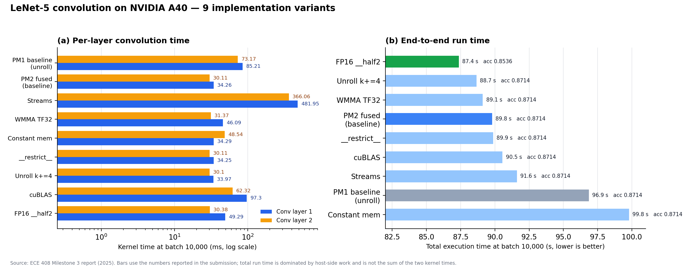
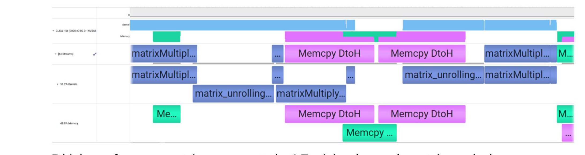
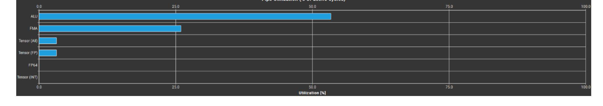
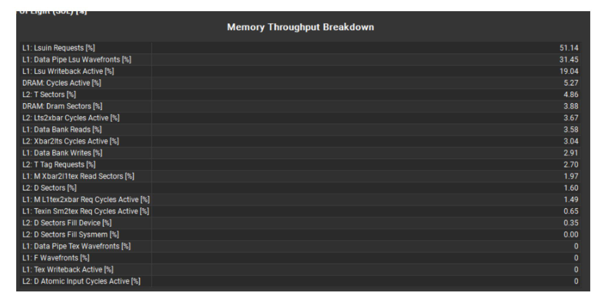
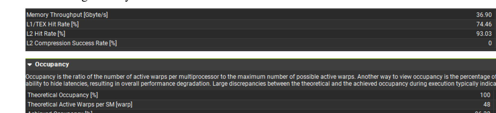
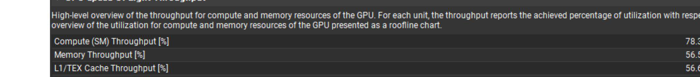
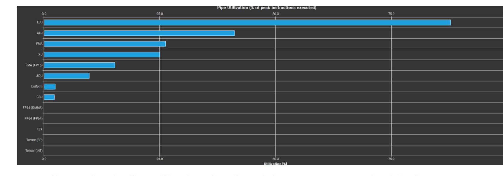

# ECE 408 — GPU Convolution / GEMM Optimization on NVIDIA A40

**Profiling-driven optimization of a LeNet-5 convolution layer: im2col + fused GEMM, CUDA streams, Tensor Cores (TF32 WMMA), constant memory, `__restrict__`, loop unrolling, cuBLAS and FP16.**


Course project for **ECE 408: Applied Parallel Programming**, University of Illinois
Urbana-Champaign, Spring 2025. The project accelerates the two convolution layers of a
LeNet-5 inference pass over 10,000 Fashion-MNIST images on a single NVIDIA A40.

This repository contains the **full 21-page report**, the **raw Nsight Compute / Nsight
Systems traces** behind every number in it, the **Tensor Core kernel source**, and a
machine-readable **results table**.

---

## TL;DR

| Aspect | Result |
|---|---|
| **Starting point** | Naive unrolled convolution + separate GEMM: **85.2 ms + 73.2 ms** per layer (batch 10,000, 96.9 s end-to-end) |
| **Fused im2col kernel** | **34.3 ms + 30.1 ms** — **2.5×** faster per layer, 89.8 s end-to-end |
| **Further variants** | 7 more variants (streams, TF32 WMMA, constant memory, `__restrict__`, unroll, cuBLAS, FP16) — **none beat the fused kernel on per-layer time**; each was profiled to explain *why* |
| **Best end-to-end** | **87.4 s** with FP16 `__half2` (accuracy 0.8714 → 0.8536) |
| **Main lesson** | At this size the convolution is launch- and bandwidth-bound, not FLOP-bound. Profiling, not guesswork, decided which optimizations were worth keeping. |

---

## Results



Batch 10,000, single A40, two convolution layers. "Total" is the end-to-end run time
reported by the harness (data loading + all layers), so it is **not** the sum of the two
kernel times.

| Variant | Conv-1 (ms) | Conv-2 (ms) | Total (s) | Accuracy | Verdict |
|---|---:|---:|---:|---:|---|
| PM1 baseline — unrolled conv + GEMM | 85.21 | 73.17 | 96.86 | 0.8714 | reference |
| **PM2 fused — im2col + single kernel** | **34.26** | **30.11** | **89.79** | 0.8714 | **2.5× vs PM1** |
| Req_0 — 3 CUDA streams + pinned memory | 481.95 | 366.06 | 91.61 | 0.8714 | overlap works, launch overhead wins |
| Req_1 — Tensor Cores, TF32 WMMA 16×16×8 | 46.09 | 31.37 | 89.11 | 0.8714 | tensor pipe active but starved |
| OP_0 — weights in `__constant__` | 34.29 | 48.54 | 99.79 | 0.8714 | broadcast defeated by divergence |
| OP_1 — `__restrict__` pointers | 34.25 | 30.11 | 89.87 | 0.8714 | better caches, no time win |
| OP_2 — manual unroll `k += 4` | 33.97 | 30.10 | 88.66 | 0.8714 | best per-layer time, tiny margin |
| OP_4 — cuBLAS `Sgemm` | 97.30 | 62.32 | 90.55 | 0.8714 | memory-bound at 93.9 % |
| OP_5 — FP16 `__half2` / `__hfma2` | 49.29 | 30.38 | **87.37** | 0.8536 | best total, small accuracy cost |

All 27 measurements (three batch sizes × nine variants) are in
[`analysis/results.csv`](analysis/results.csv); the plot is generated by
[`analysis/make_charts.py`](analysis/make_charts.py).

---

## The problem

LeNet-5, Fashion-MNIST, batch 10,000, FP32:

| Layer | Input | Weights | Output |
|---|---|---|---|
| conv-1 | 1 × 32 × 32 | 6 × 1 × 5 × 5 | 6 × 28 × 28 |
| conv-2 | 6 × 28 × 28 | 16 × 6 × 5 × 5 | 16 × 24 × 24 |

The reference implementation expresses convolution as three steps:

```
im2col (unroll)  ->  GEMM (mask × unrolled input)  ->  permute  ->  NCHW output
```

The unrolled matrix for conv-2 is `(6×5×5) × (10000×24×24)` floats — **864 M elements, ≈3.5 GB**
(conv-1 is ≈0.8 GB). That single fact explains most of the results below: the kernel is
dominated by writing and re-reading this matrix, not by arithmetic.

**PM1** (the naive version) launches three kernels and materialises both intermediate
buffers. **PM2** fuses im2col into the GEMM kernel (`matmul_conv_fused`) so the unrolled
tile never round-trips through global memory. That is where the 2.5× comes from.

> Scope note: the parameter sweep (OP_3) was not completed, so it is absent from the
> report and from this repository. Everything else that was measured is included.

---

## What each experiment showed

### 1. Fusion is the real win — 2.5×

Eliminating the ≈3.5 GB intermediate buffer and two kernel launches per layer takes the two
layers from **85.2 / 73.2 ms** to **34.3 / 30.1 ms**. Everything measured afterwards starts
from this fused baseline, and the remaining headroom turns out to be small.

### 2. Streams: the timeline is beautiful, the timing is not

3 streams × 32-image segments, pinned host memory, `cudaMemcpyAsync`, three kernels per
segment. Nsight Systems confirms genuine copy/compute overlap:



`Memcpy DtoH` (purple) runs underneath `matrixMultiply` (blue), and the kernel:memory ratio
is near 1 — the textbook sweet spot. But the per-layer timer reports **482 / 366 ms**:
splitting 10,000 images into ~312 segments multiplies launch and allocation overhead, and at
batch 100 the total run time gets *worse* (3.45 s vs 1.43 s). Overlap cannot pay for a
pipeline this fine-grained.

### 3. Tensor Cores: the instruction works, the occupancy does not

`wmma` TF32 fragments with a 16×16×8 shape, one warp per block, shared-memory staging
(see [`src/conv_tensor_core_wmma.cu`](src/conv_tensor_core_wmma.cu)). Nsight Compute's pipe
utilization proves the tensor path is live — `Tensor (FP)` ≈ **4.6 %** — but ALU is 54 % and
FMA 27 %, and the tensor pipe is starved:



Only **~4 active warps/scheduler** (hardware allows 12), ~1.5 eligible, < 1 issued per cycle.
Result: **46.1 / 31.4 ms**, slower than the FP32 fused kernel. Tensor Cores need many
concurrent warps to hide MMA latency; one warp per block cannot supply them.

### 4. Constant memory: broadcast only helps if the warp agrees

Weights (≤ 64 KB) in `__constant__`, with a runtime fallback to global memory for larger
masks. Nsight Compute shows the reads really are served by the constant cache — L2 tag
requests **2.70 %**, L2 sector traffic **1.60 %**, L2 fills **0.35 %**:



But threads in a warp touch *different* weights (`row_out * C*K*K + weight_idx`), so the
broadcast path never engages; accesses serialise. Conv-2 regresses from 30.1 ms to
**48.5 ms**. The optimization was correct and still slower — a useful negative result.

### 5. `__restrict__`: better caches, no measurable speedup

Tagging input, mask and output pointers as non-aliasing gives the compiler freedom to
reorder loads. The profile is healthy — **74.46 % L1 hit rate, 93.03 % L2 hit rate,
96.32 % achieved occupancy, 46.23 active warps/SM**:



Per-layer time: **34.25 / 30.11 ms**, i.e. noise-level change. The fused kernel was already
not memory-stall-bound.

### 6. Loop unrolling: 78.3 % SM utilization, lower occupancy

Manually unrolling the `k` loop by 4 (`k += 4`) raises arithmetic intensity to
**19.72 FLOP/byte** and single-precision throughput to **728 GFLOP/s**, with SM throughput
at **78.30 %**:



Yet the unrolled body increases register pressure and cuts achieved occupancy, so the
per-layer time barely moves (**33.97 / 30.10 ms**) and the total is 88.66 s. This is the
number that usually gets quoted as "78.3 % SM utilization" — it is real, but it did **not**
translate into a proportional speedup, and the report says so.

### 7. cuBLAS: a vendor GEMM cannot fix a bandwidth problem

Replacing the GEMM with `cublasSgemm` hands the work to `gemmSN_NN_kernel_64addr`, which
runs at **93.93 % memory throughput** and only 22.87 % compute throughput (IPC ≈ 0.69):

**97.3 / 62.3 ms** — slower than the hand-written fused kernel, because the ≈3.5 GB unrolled
matrix is still there. This is the clearest demonstration that the bottleneck is data
movement, not matrix-multiply quality.

### 8. FP16: best end-to-end, small accuracy cost

A packing kernel converts FP32 to `__half2`, shared memory holds packed halves, and
`__hfma2` does two FMAs per instruction. `FMA (FP16)` pipe utilization reaches ~35 %, and
the run is the fastest end-to-end (**87.37 s**) with accuracy **0.8536** (from 0.8714).

Per-layer time is *worse* than FP32 (**49.3 / 30.4 ms**) because of packing and odd-length
edge handling — but the smaller memory footprint wins overall.



---

## What I would do next

- **Occupancy first for WMMA**: 4+ warps per block, double-buffered `cp.async` staging,
  `m16n16k16` FP16 MMA instead of TF32 `16x16x8`.
- **Drop im2col entirely**: implicit-GEMM convolution removes the 960 MB buffer instead of
  making it faster to traverse.
- **CUDA Graphs** for the stream pipeline: the overlap is real; the launch overhead is what
  kills it.
- **Finish the parameter sweep** (block size, tile size, unroll factor, stream count) with
  the same measurement discipline used here.

---

## Repository layout

```
docs/
  report/ECE408_M3_GEMM_Optimization_Report.pdf   21-page report (image-based, as submitted)
  figures/                                         ncu/nsys screenshots + generated chart
analysis/
  results.csv                                      all 27 measurements
  make_charts.py                                   regenerates docs/figures/results-batch10000.png
src/
  conv_tensor_core_wmma.cu                         TF32 WMMA kernel + unroll/permute kernels
profiling/
  req_0/  req_1/  op_0/  op_1/  op_2/  op_4/  op_5/
                                                   raw .ncu-rep / .nsys-rep traces and .out logs
```

## Inspecting the traces

The `.ncu-rep` and `.nsys-rep` files are stored with **Git LFS**:

```bash
git lfs install
git clone https://github.com/YanhaoYang2/ECE408_GPU_Conv_Optimization.git
```

| File | Tool | What it shows |
|---|---|---|
| `profiling/req_0/req_0.nsys-rep` | Nsight Systems | stream/copy/compute overlap timeline |
| `profiling/req_0/streams_analysis_file.ncu-rep` | Nsight Compute | stream kernel metrics |
| `profiling/req_1/tensorcore_analysis_file.ncu-rep` | Nsight Compute | pipe utilization, warps/scheduler |
| `profiling/op_0/constantweight_analysis_file.ncu-rep` | Nsight Compute | constant-cache traffic |
| `profiling/op_1/restrict_analysis_file.ncu-rep` | Nsight Compute | L1/L2 hit rates, occupancy |
| `profiling/op_2/loopunrolling_analysis_file.ncu-rep` | Nsight Compute | SM SOL, arithmetic intensity |
| `profiling/op_4/cublas_analysis_file.ncu-rep` | Nsight Compute | cuBLAS memory-bound profile |
| `profiling/op_5/fp16_analysis_file.ncu-rep` | Nsight Compute | FP16 pipe utilization |

Open a report with `ncu --import <file>.ncu-rep` or the Nsight Compute GUI; `.nsys-rep`
opens in Nsight Systems.

## The report

[`docs/report/ECE408_M3_GEMM_Optimization_Report.pdf`](docs/report/ECE408_M3_GEMM_Optimization_Report.pdf)
— 21 pages, with PDF bookmarks for each section. The pages are image-based (the submission
was rendered from Google Docs); only the placeholder header was replaced with my name, the
body is untouched. The original rubric/grade pages are not included.

## License

- **Code** (`src/`, `analysis/`): MIT — see [LICENSE](LICENSE).
- **Report, figures and profiling data**: © 2025 Yanhao Yang, shared for portfolio and
  reference. Please do not submit them as your own coursework.

This is coursework completed in Spring 2025 and is published after the course ended, for
demonstration purposes.

---

## 中文摘要

ECE 408（UIUC，2025 春）课程项目：在单张 NVIDIA A40 上优化 LeNet-5 的两层卷积
（Fashion-MNIST，batch 10,000）。

- **核心收益来自融合**：im2col + 单 Kernel 融合（`matmul_conv_fused`）把两层卷积从
  **85.2 / 73.2 ms** 降到 **34.3 / 30.1 ms（2.5×）**，消除了约 960 MB 中间矩阵的
  全局内存往返。
- **之后系统评估了 7 种优化**：CUDA Streams、TF32 WMMA、constant memory、
  `__restrict__`、循环展开、cuBLAS、FP16 `__half2`。逐层耗时都没有明显超过融合基线，
  报告用 Nsight Compute/Systems 的数据解释了每一个"为什么没变快"。
- **端到端最好的是 FP16**：87.4 s，精度 0.8714 → 0.8536。
- **关键结论**：这个尺寸的卷积是启动开销和带宽受限，不是 FLOP 受限；先测量、再优化。
- 仓库包含完整 21 页报告、27 组测量数据、Tensor Core 内核源码，以及全部原始
  ncu-rep / nsys-rep 剖析文件（Git LFS）。
